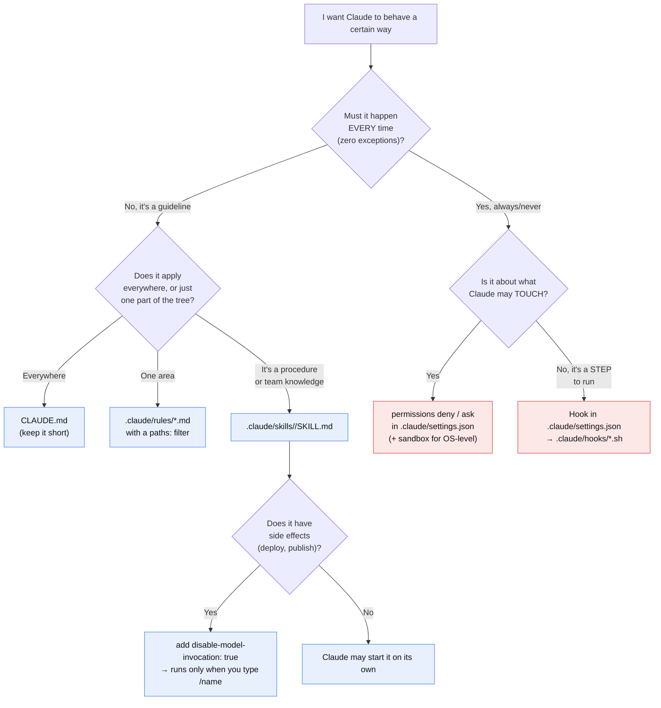
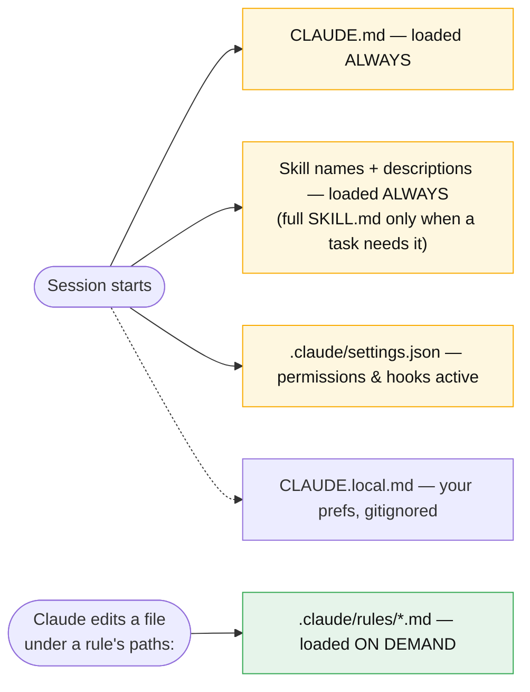
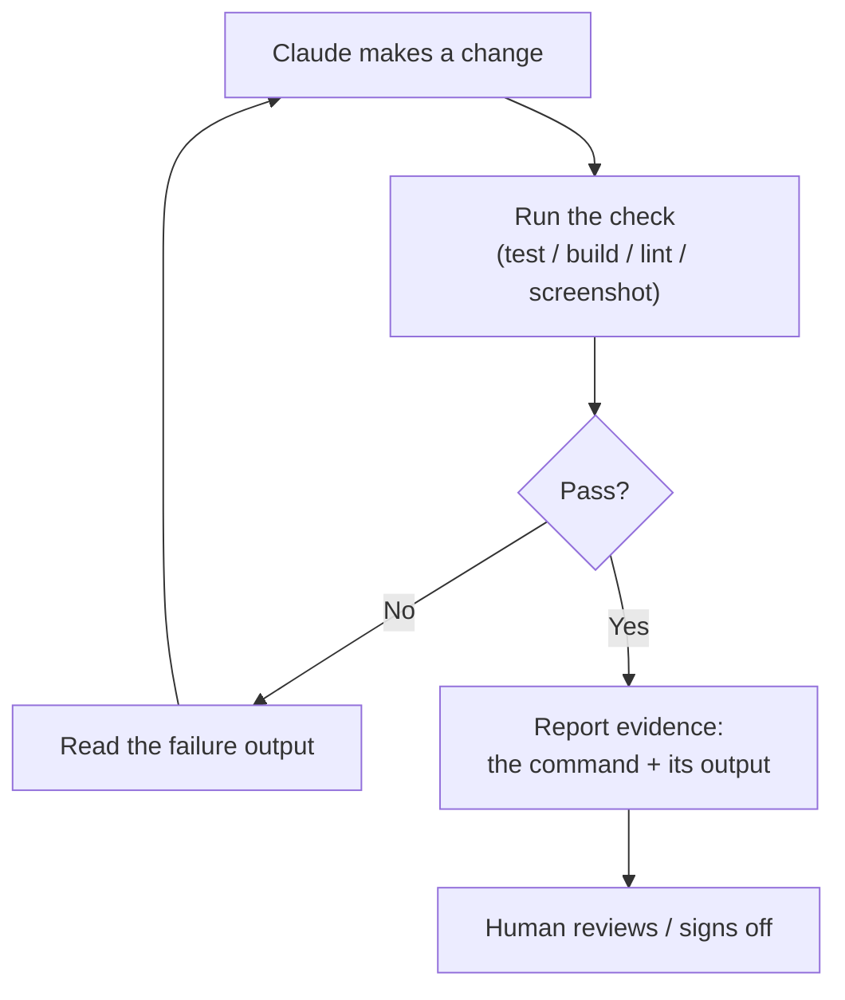
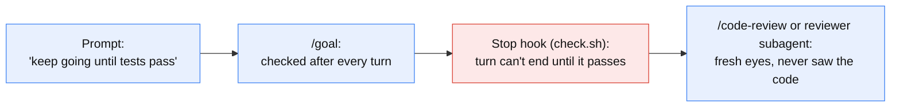
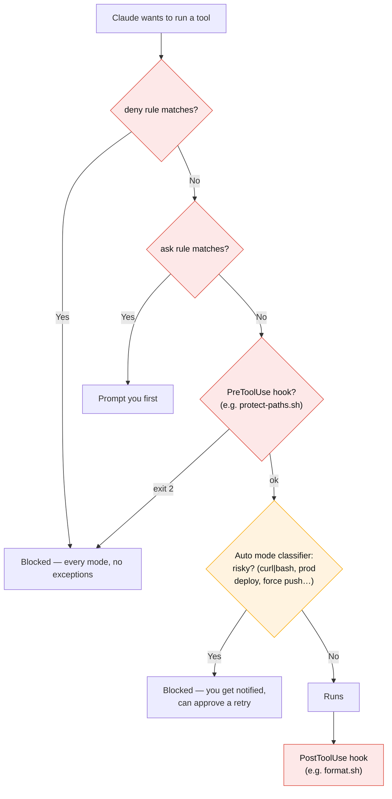
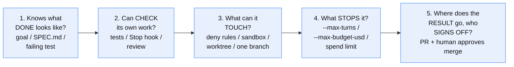

# Diagrams

Mermaid diagrams for the practices in [`how-to-use.md`](how-to-use.md). They render on GitHub and
in most Markdown viewers.

## 1. Where does this instruction go?

The single most useful decision. Start from what you want and follow it to the right file.

Blue = **non-deterministic** (Claude decides). Red = **deterministic** (the harness enforces).

## 2. What loads, and when

`CLAUDE.md` costs attention on every task; skills and rules are nearly free until needed.

> Takeaway: put always-relevant, can't-read-from-code facts in `CLAUDE.md`; push area-specific
> rules into `.claude/rules/` and long procedures into skills so they don't weigh on every task.

## 3. The "give Claude a check" loop

A check that returns pass/fail lets Claude close the loop itself instead of making you the test suite.

Enforcement ladder for the same check — pick as much teeth as the task needs:

## 4. How a tool call is evaluated

Your deterministic controls run **before** auto mode's classifier, so a deny rule always wins.

## 5. Before you leave a run unattended

The five questions. If you can't answer one, the run isn't ready to go unwatched.

